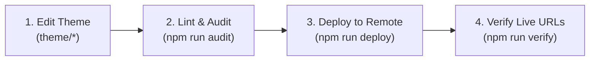

# AGENTS.md — SFPE Australia Repository Guidelines

This document provides definitive instructions, architectural standards, and strict constraints for any AI coding agent working in this repository.

---

## 1. Project Mission & Identity

**SFPE Australia** is the official chartered Australian Chapter of **The Society of Fire Protection Engineers (SFPE)**.

- **Live Staging Website**: [https://sfpe.xo.je/](https://sfpe.xo.je/)
- **Core Strategic Positioning**:
  > *"SFPE Australia is the window between Australian practice and international fire safety engineering research and practice."*
- **Role in the Ecosystem**:
  - SFPE Australia does not compete with or replace the **Society of Fire Safety (SFS / Engineers Australia)**. Domestic initiatives are executed in partnership with SFS, AIDGC, and academic research hubs (University of Queensland, RMIT).
  - International knowledge transfer (SFPE Handbook updates, UL FSRI, NFPA FPRF research, global sister chapters in New Zealand and the UK) is led by SFPE Australia.

---

## 2. Invariant Terminology & Branding Rules

All agents **must strictly adhere** to these naming and terminology rules across all templates, copy, and documentation:

### Brand Identity
1. **Brand Subtitle**:
   - In both `header.php` and `footer.php`, the subtitle under `SFPE Australia` **MUST ALWAYS BE**:
     ```html
     <span class="brand-subtitle">Society of Fire Protection Engineers</span>
     ```
   - **NEVER** write `"Fire Safety Engineering"` as the subtitle for SFPE Australia. SFPE stands for The Society of Fire Protection Engineers.
2. **Top Bar Tagline**:
   - Must state: `Australian Chapter • The Society of Fire Protection Engineers (SFPE)`.
   - Do not refer to the chapter as an "affiliated third party" or "independent body". It is the official chartered Australian chapter.

### Discipline Terminology
- **International Discipline**: *Fire Protection Engineering (FPE)* (used by SFPE Global, SFPE Foundation, international standards, and the SFPE Handbook).
- **Australian Domestic Discipline**: *Fire Safety Engineering (FSE)* (used within the National Construction Code / Building Code of Australia (NCC/BCA) performance-based regulatory framework).
- **The Discussant Model**: Every international seminar features an **International Presenter** (who brings global research or handbook updates) paired with an **Australian Discussant** (a senior local practitioner who contextualizes the science for Australian BCA Performance Solutions and Australian Standards).

### Working Groups & Chairs
- **Technical Program**: Dan Rathnayaka (assisted by Dr. Jonathan Barnett)
- **Partnerships & Alliances**: Michael Beecroft (assisted by Dr. Jonathan Barnett)
- **Digital & Membership**: Dr. Amer Magrabi (built by Ninh Ha)
- **Sponsorship & Development**: Dr. Frank Mendham (assisted by Derya Horasan)

---

## 3. Strict Style & Design Constraints

This repository enforces strict design quality standards. The audit script (`npm run audit`) will fail if any of these rules are violated:

1. **ZERO Em-Dashes (`—`)**:
   - Never use the Unicode em-dash character (`—`).
   - Use standard hyphens (`-`), colons (`:`), or rewrite the sentence.
2. **ZERO AI-Purple**:
   - Never use purple accent hues (`#7c3aed`, `#8b5cf6`, `#6366f1`, `#4f46e5`, `#a855f7`, `#9333ea`) or rainbow gradient backgrounds.
   - Use the approved brand palette: Primary Navy (`#0B132B`), Accent Blue (`#0072BB`), Fire Crimson (`#D32228`), Surface (`#FFFFFF`), and Canvas (`#F8FAFC`).
3. **ZERO Inter Font**:
   - Never use `Inter`.
   - Typography stack: Headings use `Plus Jakarta Sans`; body text uses `Public Sans`.
4. **ZERO Marketing Buzzwords / Filler Copy**:
   - Forbidden terms: `cutting-edge`, `game-changing`, `seamlessly`, `delve`, `harness`, `elevate`, `unleash`, `tapestry`, `testament`.
   - Maintain an authoritative, professional, engineering-grade tone suitable for chartered engineers and academics.
5. **Contact Inquiries**:
   - All contact and registration notifications currently route to `haninh1997@gmail.com`.

---

## 4. Repository Structure

```
SFPE/
├── AGENTS.md               # This instructions file
├── README.md               # Repository overview & setup guide
├── package.json            # NPM scripts for deployment, audit, and verification
├── .gitignore              # Ignored files (node_modules, caches, temporary files)
├── theme/                  # Standalone WordPress theme source files
│   ├── style.css           # Theme styles (v5.0.0, fluid typography, 1400px container)
│   ├── functions.php       # Post types, enqueue scripts, custom meta fields
│   ├── header.php          # Global header, mobile navigation, brand mark
│   ├── footer.php          # Global footer, contact links, brand mark
│   ├── index.php           # Fallback WordPress template
│   ├── front-page.php      # Main homepage template
│   ├── page-home.php       # Home page template alias
│   ├── page-about.php      # About Us & leadership directory
│   ├── page-webinars.php   # 6-session webinar pipeline & alert signup
│   ├── single-webinar.php  # Single webinar session detail template
│   ├── page-working-groups.php # 4 working groups with terms & mandates
│   ├── page-cpd-hub.php    # Engineers Australia CPD guidance & partner hub
│   ├── page-contact.php    # Join & inquiry form
│   └── images/             # Theme image assets
│       ├── sfpe-australia-logo.png
│       └── hero-australia-bg.jpg
├── assets/                 # Raw high-resolution assets
│   ├── branding/           # Logos and vector files
│   └── imagery/            # Landscape imagery and backgrounds
├── scripts/                # Automation and deployment tools
│   ├── deploy.js           # Pushes theme/ to remote WordPress and clears cache
│   ├── purge-cache.js      # Flushes remote page_enhanced cache & object cache
│   ├── verify.js           # Tests all 6 live URLs for HTTP 200 and branding
│   ├── audit.js            # Lints theme files for design violations
│   └── seed-site.js        # Seeds database pages and webinar custom posts
├── docs/                   # Specifications, architecture, and meeting minutes
│   ├── ARCHITECTURE.md     # Technical and information architecture
│   └── MINUTES.md          # Founding meeting minutes (08 Sept 2026)
└── archive/                # Historical one-off migration and deploy scripts
```

---

## 5. Development & Deployment Workflow

When making modifications to the website, follow this exact workflow:



### Step 1: Edit Theme Files Directly
- **Always edit files in the `theme/` directory**.
- Do not edit files in `archive/` or hardcode base64 strings in standalone scripts.
- Ensure all CSS modifications use CSS custom properties defined in `theme/style.css`.
- Ensure responsive layouts use `clamp()` for fluid typography and preserve symmetric 2×2 mobile stat grids.

### Step 2: Audit Design Rules
Run the local linter before deploying:
```bash
npm run audit
```
This script checks for em-dashes, AI purple, forbidden fonts, and marketing filler copy.

### Step 3: Deploy to Remote
Deploy all files in `theme/` to the remote WordPress instance:
```bash
npm run deploy
```
This script uses `@novamira/cli` (`execute-php`) to upload all template files and images to `wp-content/themes/sfpe-theme/` and automatically executes `purgeCache()`.

### Step 4: Verify Live URLs
Validate that all 6 public URLs return HTTP 200 and display the correct brand subtitle:
```bash
npm run verify
```

### Manual Cache Purge
If the live website ever shows stale content or older cached HTML, run:
```bash
npm run purge-cache
```

---

## 6. Remote Environment Notes

- **Hosting Provider**: InfinityFree (OpenResty web server).
- **Anti-Bot Mechanism**: OpenResty requires an AES challenge cookie (`__test=...`). `scripts/verify.js` handles cookie persistence automatically.
- **Remote Execution**: Sandboxed PHP execution is performed via `@novamira/cli` (`novamira run novamira/execute-php`).
