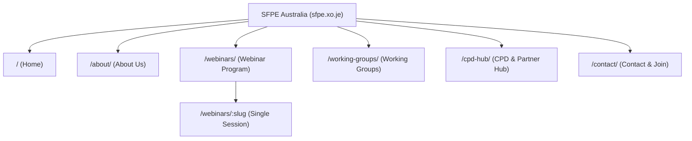

# SFPE Australia Website Architecture

## Overview
The **SFPE Australia** digital platform is an official, custom-engineered WordPress theme built specifically for the Australian Chapter of **The Society of Fire Protection Engineers (SFPE)**.

- **Live Staging URL**: [https://sfpe.xo.je/](https://sfpe.xo.je/)
- **Theme Name**: `sfpe-theme` (Version 5.0.0)
- **Primary Font Stack**:
  - Headings: `Plus Jakarta Sans`, sans-serif
  - Body: `Public Sans`, -apple-system, BlinkMacSystemFont, Segoe UI, Roboto, sans-serif
- **Brand Palette**:
  - Primary Navy: `#0B132B` (Dark: `#070D1E`)
  - Accent Blue: `#0072BB` (Hover: `#005A96`, Soft: `#E0F2FE`)
  - Fire Crimson: `#D32228` (Hover: `#B51B20`, Soft: `#FEE2E2`)
  - Background Canvas: `#F8FAFC`
  - Text Ink: `#0F172A` (Muted: `#475569`, Subtle: `#64748B`)
  - Surface: `#FFFFFF` (Surface Alt: `#F1F5F9`)

---

## 1. Information Architecture

### Core Pages
1. **Homepage (`/`)**:
   - Hero banner with Australian landscape imagery overlay and the global-local discipline bridge.
   - Symmetric 4-card statistics bar (Webinars, Working Groups, CPD hours, Official Chapter status).
   - Three Strategic Pillars (Connecting Communities, Global Science Dissemination, The Discussant Model).
   - Featured webinar sessions spotlight.
   - Working Groups overview grid.
   - CPD recognition highlight.
2. **About Us (`/about/`)**:
   - Chapter charter and mission statement.
   - Detailed Executive Committee & Working Group Leadership directory.
   - Higher education alliances (University of Queensland Fire Lab, RMIT, SFPE Foundation).
3. **Webinar Program (`/webinars/`)**:
   - The 6-session annual webinar pipeline.
   - The Discussant Model breakdown (Global Presenter + Australian Discussant).
   - Interactive notification/alert signup form routing to `haninh1997@gmail.com`.
4. **Working Groups (`/working-groups/`)**:
   - Dedicated section for each of the 4 working groups:
     1. Technical Program
     2. Partnerships & Alliances
     3. Digital & Membership
     4. Sponsorship & Development
   - Leadership, active initiatives, and volunteer involvement pathways.
5. **CPD Hub (`/cpd-hub/`)**:
   - Engineers Australia Chartered Professional Engineer (CPEng) and NER self-reporting guidelines.
   - Verified CPD hours tracking breakdown (Type II & Type III).
   - Partner organization links (SFS, AIDGC, IFE, SFPE Foundation, SFPE New Zealand, SFPE UK).
6. **Contact & Join (`/contact/`)**:
   - Inquiries, speaker proposals, and membership interest form.
   - Direct correspondence routing to `haninh1997@gmail.com`.
   - SFPE International membership portal link.

---

## 2. WordPress Custom Post Types & Meta

The theme registers a dedicated `webinar` Custom Post Type in `functions.php`:

### Post Type: `webinar`
- **Slug**: `/webinars/%postname%/`
- **Menu Icon**: `dashicons-video-alt3`
- **Supports**: `title`, `editor`, `excerpt`, `thumbnail`, `page-attributes`
- **Custom Meta Fields**:
  - `_webinar_session_number`: String (e.g., `Session 1 of 6`)
  - `_webinar_partner`: String (e.g., `AIDGC Alliance`, `SFPE International`)
  - `_webinar_speaker`: String (e.g., `Sean Page, President, AIDGC`)
  - `_webinar_discussant`: String (e.g., `Australian Dangerous Goods Discussant`)
  - `_webinar_status`: Enum / String (`Next Up`, `Pipeline Confirmed`, `In Development`)
  - `_webinar_date_display`: String (e.g., `Early 2027`)

---

## 3. Responsive Layout & Typography Engine

### Fluid Scaling (`clamp()`)
To ensure optimal presentation on viewports ranging from 320px mobile screens to 2560px ultrawide displays:
- **Container Max-Width**: `1400px` (`--container-max: 1400px`)
- **Fluid Container Padding**: `clamp(20px, 3.5vw, 48px)`
- **Hero Title**: `clamp(36px, 4vw, 58px)`
- **Section Titles**: `clamp(30px, 2.7vw, 44px)`
- **Body Text**: `clamp(16px, 0.95rem + 0.2vw, 18px)`
- **Stat Figures**: `clamp(38px, 3.4vw, 54px)`

### Mobile Adaptations
- **Stat Tiles**: 2×2 symmetric rounded grid (`background: rgba(255, 255, 255, 0.04); border: 1px solid rgba(255, 255, 255, 0.08);`).
- **Webinar Specs**: Flex-direction shifts to column (`label` above `value`) on small screens to prevent text collisions.
- **Header Drawer**: Accessible 44×44px hamburger button with sticky navigation drawer and elevation shadows.
- **Horizontal Overflow Protection**: `overflow-x: hidden;` applied to `html` and `body`.

---

## 4. Cache & Hosting Mechanics

The hosting environment runs on InfinityFree with OpenResty edge proxies:
1. **OpenResty Anti-Bot Proxy**: Requires an AES challenge-response cookie (`__test=...`) to access the origin. Automation scripts handle cookie persistence automatically via `scripts/verify.js`.
2. **Server-Side Static Cache**: Stored in `wp-content/cache/page_enhanced/`.
   - Running `npm run purge-cache` or `npm run deploy` automatically purges this directory and executes `wp_cache_flush()`.
3. **HTTP Client Bridge**: `@novamira/cli` (`novamira run novamira/execute-php`) executes sandboxed PHP commands to write files and configure the database without requiring direct FTP/SSH.
